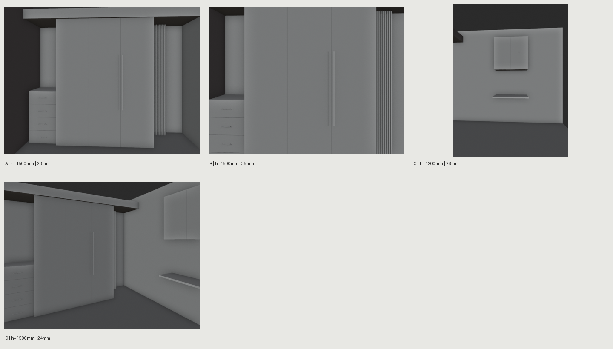

# CAD Cabinet White Model / CAD柜体白模与机位

A portable Codex skill for dimension-led cabinet modeling and efficient camera proofs in Blender.

**读CAD → 参数化白模 → 多机位小样 → 选定高清。** 用一个项目配置持续记录尺寸与机位，复用脚本，减少反复写程序和提前渲染高清。

## 安装与使用

下载本仓库后运行 `python3 install.py`，下一轮Codex即可使用。或让Codex用skill-installer安装仓库中的 `skills/cad-cabinet-white-model`。

在Codex里直接说：

> 用 $cad-cabinet-white-model 按这组CAD做衣帽间白模。先核对尺寸，给我衣柜、梳妆台和门口的编号机位小样；选定后出高清。

已有模型也能说：

> 用 $cad-cabinet-white-model 把梳妆台视高改成1.2m，角度更正，不改变柜体尺寸，先给我几个小样。



*合成样例的快速机位小样，用于构图和几何检查。*

## 包含什么

- 常规柜体、门板分格、抽屉前面板、格栅、bar/F/knob拉手、多边形挤出及45°门板边截面。
- 同进程批量渲染机位小样；编号、视高、焦距、包围盒入镜检查；PNG与离线HTML联系表。
- 明确选定机位才输出高清；相机修改前后对比几何指纹；缓存验证源文件、参数与输出内容。
- 新建模型的尺寸与基础拓扑检查；已有模型保留源文件，另存调整后的场景。
- 只需Blender与Python标准库。Pillow可选，用来合成一张PNG联系表。无云服务、API密钥或生命周期hooks要求。

## 命令行示例

将合成示例复制到自己的工作目录，按图纸修改。设工作路径后依次执行：

```bash
python3 skills/cad-cabinet-white-model/scripts/workflow.py validate --project project.json
python3 skills/cad-cabinet-white-model/scripts/workflow.py build --project project.json --out work/model
python3 skills/cad-cabinet-white-model/scripts/workflow.py preview --project project.json --blend work/model/model.blend --out work/proofs
python3 skills/cad-cabinet-white-model/scripts/workflow.py final --project project.json --blend work/model/model.blend --out work/final --cameras A C
```

完整配置见 [项目格式](skills/cad-cabinet-white-model/references/project-format.md)。默认小样长边640，高清长边2400，可用 `--size` 和 `--samples` 调整；`--blender` 指定可执行文件。默认自动检测GPU；`--device CPU`用于无GPU环境。各视图有不同画幅或隐藏对象时，请继续通过脚本渲染，单独切换相机不会同步全部参数。

## 准确性与范围

此工具帮助代理按明确尺寸建模，并不自动识别所有DWG、推断缺失尺寸或认证制造精度。CAD读取和取舍由代理结合用户提供资料完成，所有估算需记录。内部滑轨、布帘、复杂曲面与特定家具造型按项目补建。

包围盒在画内不代表没有遮挡；较长焦距也不独自保证自然透视。代理必须检查小样与图纸。基础拓扑检查不等于完整资产QA。减少返工是设计目标，未经同项目对照测试，不宣称具体速度或token节省比例。

仓库只含通用代码、文档与合成示例；私人CAD、现场照片、客户尺寸表及本机路径不属于发布内容。

## 验证

```bash
python3 -m unittest discover -s tests -v
python3 tests/integration.py --blender /path/to/blender
```

Blender集成检查脚本 `tests/blender_assertions.py` 在已生成的合成示例模型上运行，检查尺寸、门板/抽屉数量、网格复用和45°截面。仅宣称实际测试过的Blender版本，参见 [验证记录](VALIDATION.md)。

License: MIT.
